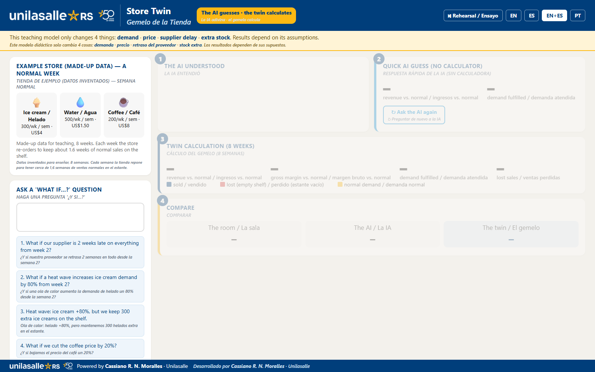
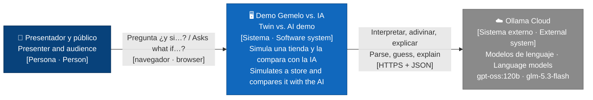
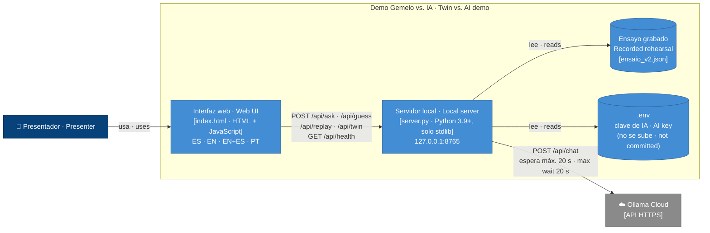
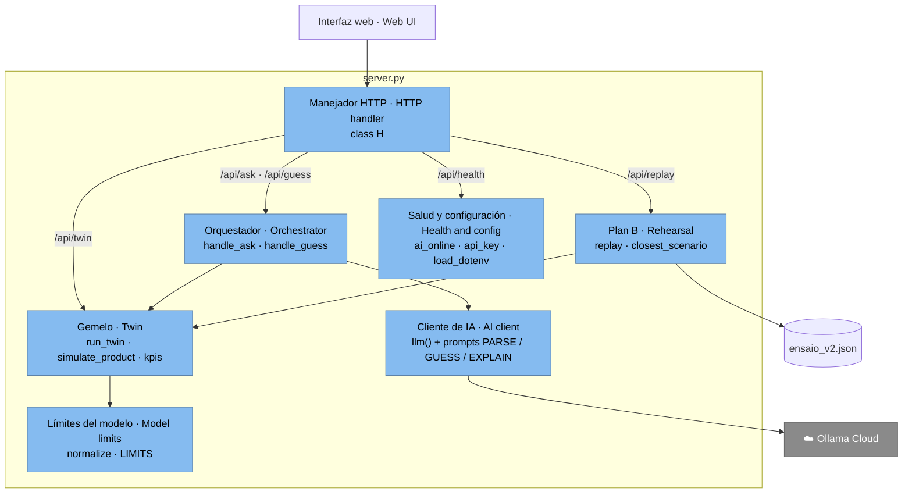
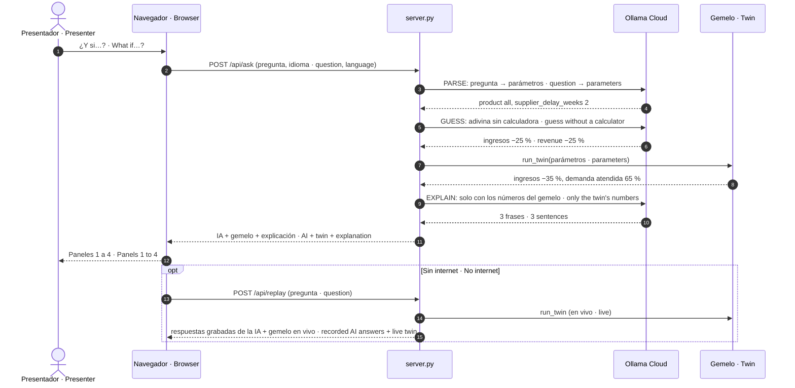
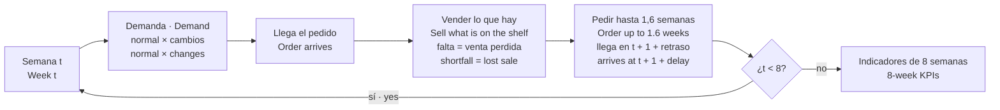
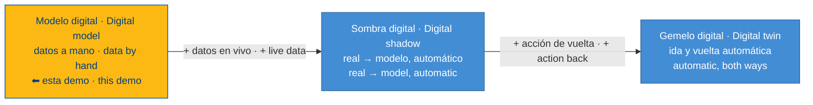
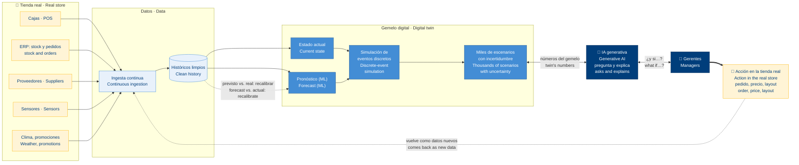

# Gemelos digitales vs. IA · Digital Twins vs. AI

<p align="center">
<em>La IA adivina, el gemelo calcula.</em> · <em>The AI guesses, the twin calculates.</em><br>
<sub>International Business Week · Unilasalle-RS · 11/11/2026 · MIT</sub>
</p>



**Contenido · Contents:** [Arquitectura C4 · C4 architecture](#c4) · [Cómo se simula el gemelo · How the twin is simulated](#simulacion) · [Un gemelo real · A real twin](#gemelo-real) · [Fuentes · Sources](#fuentes) · [Inicio rápido · Quick start](#quick-start)

<table>
<tr>
<th width="50%">🇪🇸 Español</th>
<th width="50%">🇬🇧 English</th>
</tr>

<tr>
<td valign="top" width="50%">

Demo didáctica para la **International Business Week** (Unilasalle-RS). Muestra a un público de negocios, sin conocimientos técnicos, cómo trabajan juntos la **IA generativa** y un **gemelo digital**:

1. **La IA entiende** una pregunta "¿y si…?" en lenguaje común.
2. **La IA adivina** la respuesta sola, sin calculadora.
3. **El gemelo calcula** el mismo escenario con un simulador de tienda simple y transparente.
4. **Comparar**: la apuesta de la sala, la de la IA y el resultado del gemelo, lado a lado.

**Mensaje:** *la IA conversa, el gemelo calcula, y ambos deben compararse con la realidad.*

</td>
<td valign="top" width="50%">

A teaching demo for **International Business Week** (Unilasalle-RS). It shows a business audience, with no technical background needed, how **generative AI** and a **digital twin** work together:

1. **The AI understands** a "what if…?" question in plain language.
2. **The AI guesses** the answer on its own, without a calculator.
3. **The twin calculates** the same scenario with a simple, transparent store simulator.
4. **Compare** the room's guess, the AI's guess and the twin's result side by side.

**Message:** *the AI talks, the twin calculates, and both must be checked against reality.*

</td>
</tr>

<tr>
<td valign="top">

### La tienda de ejemplo

Datos inventados: **helado, agua y café**, durante **8 semanas**. Cada semana la tienda repone para tener cerca de 1,6 semanas de ventas normales en el estante.

El modelo solo cambia **4 cosas**: **demanda**, **precio**, **retraso del proveedor** y **stock extra**. Las preguntas fuera de estas palancas se marcan como "fuera de este modelo". Los valores que superan los límites se ajustan, y la pantalla muestra el ajuste.

</td>
<td valign="top">

### The example store

Made-up data: **ice cream, water and coffee**, over **8 weeks**. Each week the store re-orders to keep about 1.6 weeks of normal sales on the shelf.

The model only changes **4 things**: **demand**, **price**, **supplier delay** and **extra stock**. Questions outside these levers are flagged as "outside this model". Values beyond the limits are adjusted, and the screen shows the adjustment.

</td>
</tr>

<tr>
<td valign="top">

### Funciones

- Idiomas: **ES**, **EN**, **EN+ES** (bilingüe) y PT.
- **↻ Preguntar de nuevo a la IA**: la misma pregunta puede recibir otra respuesta. El gemelo siempre repite su número.
- **Apuesta de la sala**: el público vota antes de revelar el resultado.
- **⏯ Ensayo** (plan B): respuestas grabadas de la IA. Se activa **solo** si no hay internet al abrir o si la conexión se cae durante la charla. Una pregunta libre muestra el escenario grabado más parecido. El gemelo sigue calculando en vivo.
- Indicadores: ingresos, margen bruto, demanda atendida (unidades) y ventas perdidas (US$).

</td>
<td valign="top">

### Features

- Languages: **ES**, **EN**, **EN+ES** (bilingual) and PT.
- **↻ Ask the AI again**: the same question may get a different answer. The twin always repeats its number.
- **Room's guess**: the audience votes before the reveal.
- **⏯ Rehearsal** (plan B): recorded AI answers. It switches on **by itself** when there is no internet at start-up or the connection drops during the talk. A free question shows the closest recorded scenario. The twin still calculates live.
- KPIs: revenue, gross margin, demand fulfilled (units) and lost sales (US$).

</td>
</tr>

<tr>
<td valign="top">

### Cómo ejecutarla

Es **autocontenida**: solo necesita **Python 3.9+**, sin instalar paquetes, en **Windows, Linux o macOS**. La IA en vivo necesita internet y una clave de **Ollama Cloud**.

- **Windows:** doble clic en `INICIAR_DEMO.bat`.
- **Linux / macOS:** `./iniciar_demo.sh`.

La primera vez el script crea el `.env` a partir de `.env.example`. Ponga su clave en `OLLAMA_API_KEY` y abra http://127.0.0.1:8765.

Sin clave o sin internet, la página igual abre y el **⏯ Ensayo** se activa solo.

Comandos paso a paso: ver [abajo](#quick-start).

</td>
<td valign="top">

### Run it

It is **self-contained**: it only needs **Python 3.9+**, with no packages to install, on **Windows, Linux or macOS**. The live AI needs internet and an **Ollama Cloud** key.

- **Windows:** double-click `INICIAR_DEMO.bat`.
- **Linux / macOS:** `./iniciar_demo.sh`.

On first run the script creates `.env` from `.env.example`. Put your key in `OLLAMA_API_KEY` and open http://127.0.0.1:8765.

Without a key or internet the page still opens and **⏯ Rehearsal** switches on by itself.

Step-by-step commands: see [below](#quick-start).

</td>
</tr>

</table>

---

<a id="c4"></a>

## Arquitectura (modelo C4) · Architecture (C4 model)

<table>
<tr>
<td valign="top" width="50%">

El [modelo C4](https://c4model.com) describe un software en niveles de zoom: **contexto** (quién lo usa y con qué sistemas habla), **contenedores** (las piezas que se ejecutan), **componentes** (las partes dentro de cada pieza) y una vista **dinámica** (qué pasa en una pregunta). Los diagramas siguen el código de `server.py` e `index.html`.

</td>
<td valign="top" width="50%">

The [C4 model](https://c4model.com) describes software at zoom levels: **context** (who uses it and which systems it talks to), **containers** (the running pieces), **components** (the parts inside each piece) and a **dynamic** view (what happens for one question). The diagrams follow the code in `server.py` and `index.html`.

</td>
</tr>
</table>

### Nivel 1: Contexto · Level 1: Context



### Nivel 2: Contenedores · Level 2: Containers



### Nivel 3: Componentes de `server.py` · Level 3: Components of `server.py`



### Vista dinámica: una pregunta · Dynamic view: one question



<a id="simulacion"></a>

## Cómo se simula el gemelo en esta demo · How the twin is simulated in this demo

<table>
<tr>
<td valign="top" width="50%">

El gemelo es una **simulación de tiempo discreto, semana a semana, determinista**: la misma pregunta da siempre el mismo resultado. No usa IA ni azar.

**La tienda** (datos inventados, `PRODUCTS` en `server.py`): ver la tabla abajo.

**Reglas, cada semana:**
1. **Demanda** = venta normal × (1 + cambio de demanda) × (1 + elasticidad × cambio de precio).
2. Llega el pedido que estaba programado para esa semana.
3. **Vendido** = lo que haya en el estante, hasta la demanda. Lo que falta es **venta perdida**.
4. **Reposición:** se pide lo necesario para volver a **1,6 semanas** de venta normal en el estante, descontando lo que ya está en camino.
5. El pedido llega en **1 semana** más el **retraso del proveedor**.
6. El **stock extra** sube el nivel objetivo desde la semana anterior al escenario.

Los cambios empiezan en la **semana 2** (por defecto) y duran hasta la semana 8. Los límites son: demanda −90 % a +300 %, precio −50 % a +50 %, retraso 0 a 4 semanas, stock extra 0 a 5.000. Si se pide más, el gemelo usa el límite y la pantalla lo avisa.

**Indicadores** (totales de 8 semanas): ingresos, margen bruto (ventas − costo unitario), demanda atendida (unidades vendidas ÷ demanda) y ventas perdidas en US$.

</td>
<td valign="top" width="50%">

The twin is a **discrete-time, week-by-week, deterministic simulation**: the same question always gives the same result. It uses no AI and no randomness.

**The store** (made-up data, `PRODUCTS` in `server.py`): see the table below.

**Rules, every week:**
1. **Demand** = normal sales × (1 + demand change) × (1 + elasticity × price change).
2. The order scheduled for that week arrives.
3. **Sold** = whatever is on the shelf, up to the demand. The rest is a **lost sale**.
4. **Re-ordering:** order enough to get back to **1.6 weeks** of normal sales on the shelf, minus what is already on its way.
5. The order arrives in **1 week** plus the **supplier delay**.
6. **Extra stock** raises the target level from the week before the scenario.

Changes start in **week 2** (default) and last until week 8. Limits: demand −90% to +300%, price −50% to +50%, delay 0 to 4 weeks, extra stock 0 to 5,000. If more is asked, the twin uses the limit and the screen says so.

**KPIs** (8-week totals): revenue, gross margin (sales − unit cost), demand fulfilled (units sold ÷ demand) and lost sales in US$.

</td>
</tr>
</table>

| Producto · *Product* | Venta normal/semana · *Normal sales/week* | Precio · *Price* | Costo · *Cost* | Elasticidad · *Elasticity* |
|---|---|---|---|---|
| Helado · *Ice cream* | 300 | US$ 4.00 | US$ 2.00 | −1.5 |
| Agua · *Water* | 500 | US$ 1.50 | US$ 0.60 | −1.0 |
| Café · *Coffee* | 200 | US$ 8.00 | US$ 4.50 | −0.8 |

<sub>ES: elasticidad −1,5 = si el precio baja 10 %, la demanda sube 15 %. · EN: elasticity −1.5 = if the price drops 10%, demand rises 15%.</sub>

### El ciclo semanal · The weekly loop



### Ejemplo real del código · Real example from the code

<table>
<tr>
<td valign="top" width="50%">

**Proveedor con 2 semanas de retraso, desde la semana 2** (salida de `run_twin`; la tabla de abajo muestra solo el helado).

Los pedidos hechos desde la semana 2 tardan 3 semanas en vez de 1, así que el estante se vacía en ciclos. Con los 3 productos: ingresos **−35 %** (US$ 28.400 → US$ 18.460), demanda atendida **65 %**, US$ 9.940 en ventas perdidas. En el ensayo, la IA sin calculadora dijo **−25 %** en 5 de 6 intentos.

</td>
<td valign="top" width="50%">

**Supplier 2 weeks late, from week 2** (output of `run_twin`; the table below shows ice cream only).

Orders placed from week 2 take 3 weeks instead of 1, so the shelf empties in cycles. With all 3 products: revenue **−35%** (US$ 28,400 → US$ 18,460), demand fulfilled **65%**, US$ 9,940 in lost sales. In the rehearsal, the AI without a calculator said **−25%** in 5 of 6 tries.

</td>
</tr>
</table>

| Semana · *Week* | 1 | 2 | 3 | 4 | 5 | 6 | 7 | 8 |
|---|---|---|---|---|---|---|---|---|
| Demanda · *Demand* | 300 | 300 | 300 | 300 | 300 | 300 | 300 | 300 |
| Vendido · *Sold* | 300 | 300 | 180 | **0** | 300 | 180 | **0** | 300 |
| Perdido · *Lost* | 0 | 0 | 120 | 300 | 0 | 120 | 300 | 0 |

<a id="gemelo-real"></a>

## ¿Y cómo sería un gemelo digital real? · And what would a real digital twin look like?

<table>
<tr>
<td valign="top" width="50%">

En sentido estricto, esta demo es un **modelo digital**: los datos se cargan a mano y nada fluye solo entre la tienda y el modelo. La literatura distingue tres niveles (Kritzinger et al., 2018):

- **Modelo digital:** sin intercambio automático de datos. *Esta demo.*
- **Sombra digital:** los datos reales llegan solos al modelo, en un solo sentido.
- **Gemelo digital:** el flujo es automático en los dos sentidos: la tienda alimenta al gemelo y las decisiones del gemelo vuelven a la tienda.

En la charla lo llamamos "gemelo" para simplificar; la idea de ensayar decisiones es la misma.

</td>
<td valign="top" width="50%">

Strictly speaking, this demo is a **digital model**: data is entered by hand and nothing flows by itself between the store and the model. The literature distinguishes three levels (Kritzinger et al., 2018):

- **Digital model:** no automatic data exchange. *This demo.*
- **Digital shadow:** real data flows into the model by itself, one way only.
- **Digital twin:** the flow is automatic both ways: the store feeds the twin and the twin's decisions go back to the store.

In the talk we call it a "twin" to keep it simple; the idea of rehearsing decisions is the same.

</td>
</tr>
</table>



### Arquitectura de un gemelo real de tienda · Architecture of a real store twin



### Demo vs. gemelo real · Demo vs. real twin

| Aspecto · *Aspect* | Esta demo · *This demo* | Gemelo real · *Real twin* |
|---|---|---|
| Datos · *Data* | Inventados: 3 productos, 8 semanas<br><sub>Made-up: 3 products, 8 weeks</sub> | Ventas reales por producto y tienda (cajas, ERP), miles de productos<br><sub>Real sales per product and store (POS, ERP), thousands of products</sub> |
| Sincronización · *Sync* | Ninguna: datos a mano<br><sub>None: data by hand</sub> | Automática y continua con la tienda<br><sub>Automatic and continuous with the store</sub> |
| Demanda · *Demand* | Normal × % de cambio, elasticidad fija<br><sub>Normal × % change, fixed elasticity</sub> | Pronóstico con ML: estacionalidad, clima, promociones, eventos<br><sub>ML forecast: seasonality, weather, promotions, events</sub> |
| Incertidumbre · *Uncertainty* | Ninguna: determinista<br><sub>None: deterministic</sub> | Miles de corridas (Monte Carlo): rangos y probabilidades<br><sub>Thousands of runs (Monte Carlo): ranges and probabilities</sub> |
| Reposición · *Replenishment* | Una regla: 1,6 semanas, plazo 1 semana<br><sub>One rule: 1.6 weeks, 1-week lead time</sub> | Políticas por producto, capacidad de camión y estante, pedido mínimo<br><sub>Per-product policies, truck and shelf capacity, minimum order</sub> |
| Costos · *Costs* | Solo costo unitario<br><sub>Unit cost only</sub> | Almacenaje, merma y vencimiento, personal, transporte<br><sub>Storage, waste and expiry, staff, transport</sub> |
| Validación · *Validation* | Ninguna: es didáctica<br><sub>None: it is for teaching</sub> | Comparar previsto vs. real, medir el error, recalibrar<br><sub>Compare forecast vs. actual, measure the error, recalibrate</sub> |
| IA generativa · *Generative AI* | Adivina sola (para mostrar el contraste) y explica<br><sub>Guesses alone (to show the contrast) and explains</sub> | Interfaz de lenguaje del gemelo; no inventa números, los toma del gemelo<br><sub>Language interface to the twin; it does not invent numbers, it takes them from the twin</sub> |
| Ejemplos · *Examples* | — | Walmart: mantenimiento en 4.200 locales [4]; Lowe's: todas sus tiendas [4][5]; retail alimentario alemán en la COVID-19 con simulación de eventos discretos [3]<br><sub>Walmart: maintenance in 4,200 locations [4]; Lowe's: every store [4][5]; German food retail in COVID-19 with discrete-event simulation [3]</sub> |

<a id="fuentes"></a>

### Fuentes · Sources

1. Cosmas, A. et al. (2024). *Digital twins and generative AI: A powerful pairing*. McKinsey & Company. https://www.mckinsey.com/capabilities/tech-and-ai/our-insights/tech-forward/digital-twins-and-generative-ai-a-powerful-pairing
2. Kritzinger, W.; Karner, M.; Traar, G.; Henjes, J.; Sihn, W. (2018). Digital Twin in manufacturing: A categorical literature review and classification. *IFAC-PapersOnLine*, 51(11), 1016–1022. https://doi.org/10.1016/j.ifacol.2018.08.474
3. Burgos, D.; Ivanov, D. (2021). Food retail supply chain resilience and the COVID-19 pandemic: A digital twin-based impact analysis and improvement directions. *Transportation Research Part E*, 152, 102412. https://doi.org/10.1016/j.tre.2021.102412
4. Modern Retail (2025). *How retailers like Walmart and Lowe's use digital twins of physical stores*. https://www.modernretail.co/technology/how-retailers-like-walmart-and-lowes-use-digital-twins-of-physical-stores/ (cifras informadas por las empresas · company-reported figures)
5. Lowe's (2022). *Lowe's unveils industry-first digital twin*. https://corporate.lowes.com/newsroom/press-releases/lowes-unveils-industry-first-digital-twin-giving-associates-superpowers-better-serve-customers-09-20-22
6. Gartner (2025). *Gartner analysts answer the top generative AI questions for your enterprise*: GenAI "not well-suited for tasks that require numerical predictive modeling". https://www.gartner.com/en/topics/generative-ai

---

<table>
<tr>
<th width="50%">🇪🇸 Español</th>
<th width="50%">🇬🇧 English</th>
</tr>


<tr>
<td valign="top">

### Archivos

- `server.py`: servidor local, simulador (el gemelo) y prompts de la IA.
- `index.html`: toda la interfaz (ES / EN / EN+ES / PT).
- `ensaio_v2.json`: ensayo grabado (10/11/2026, `gpt-oss:120b`), usado por **Ensayo**.
- `ensaio_2026-11-10.json`: primer ensayo (por transparencia).
- `INICIAR_DEMO.bat` / `iniciar_demo.sh`: inicio en Windows / Linux-macOS.
- `.env.example`: plantilla de configuración.

</td>
<td valign="top">

### Files

- `server.py`: local server, simulator (the twin) and AI prompts.
- `index.html`: the whole interface (ES / EN / EN+ES / PT).
- `ensaio_v2.json`: recorded rehearsal (10 Nov 2026, `gpt-oss:120b`), used by **Rehearsal**.
- `ensaio_2026-11-10.json`: first rehearsal (kept for transparency).
- `INICIAR_DEMO.bat` / `iniciar_demo.sh`: start on Windows / Linux-macOS.
- `.env.example`: configuration template.

</td>
</tr>

<tr>
<td valign="top">

### Limitaciones

- Es un **modelo didáctico** con datos inventados, no un gemelo de una tienda real.
- El margen bruto no incluye almacenaje, merma ni personal. Los resultados dependen de los supuestos del modelo.
- Las respuestas de la IA varían en cada ejecución, y eso es parte de la lección.

</td>
<td valign="top">

### Limitations

- It is a **teaching model** with made-up data, not a twin of a real store.
- Gross margin ignores storage, waste and staff costs. Results depend on the model's assumptions.
- AI answers vary from run to run, and that is part of the lesson.

</td>
</tr>

<tr>
<td valign="top">

### Licencia

[MIT](LICENSE) © 2026 Cassiano R. N. Moralles — Unilasalle.
El nombre y el logotipo de Unilasalle no están cubiertos por la licencia.

</td>
<td valign="top">

### License

[MIT](LICENSE) © 2026 Cassiano R. N. Moralles — Unilasalle.
The Unilasalle name and logo are not covered by the license.

</td>
</tr>
</table>

<a id="quick-start"></a>

## Inicio rápido · Quick start

### 🐧 Linux / macOS

```bash
# ES: si falta Python (Debian/Ubuntu) · EN: if Python is missing (Debian/Ubuntu)
sudo apt install -y python3 git

git clone https://github.com/cass782019/digitaltwinsVSai.git
cd digitaltwinsVSai
chmod +x iniciar_demo.sh
./iniciar_demo.sh          # ES: crea .env la 1.ª vez · EN: creates .env on first run
nano .env                  # ES: complete OLLAMA_API_KEY · EN: set OLLAMA_API_KEY
./iniciar_demo.sh
```

ES: en un servidor sin escritorio (SSH) no se abre el navegador; abra `http://127.0.0.1:8765` en su máquina (por ejemplo con `ssh -L 8765:127.0.0.1:8765 usuario@servidor`).
EN: on a server without a desktop (SSH) no browser opens; open `http://127.0.0.1:8765` on your machine (e.g. with `ssh -L 8765:127.0.0.1:8765 user@server`).

### 🪟 Windows

```bat
:: ES: instale Python desde python.org y marque "Add python.exe to PATH"
:: EN: install Python from python.org and tick "Add python.exe to PATH"
git clone https://github.com/cass782019/digitaltwinsVSai.git
cd digitaltwinsVSai
INICIAR_DEMO.bat
notepad .env
INICIAR_DEMO.bat
```

ES: sin git, use **Code → Download ZIP** en GitHub, descomprima y haga doble clic en `INICIAR_DEMO.bat`.
EN: without git, use **Code → Download ZIP** on GitHub, unzip and double-click `INICIAR_DEMO.bat`.

### Configuración · Configuration (`.env`)

| Variable | Por defecto · Default | ES | EN |
|---|---|---|---|
| `OLLAMA_API_KEY` | — | Clave de Ollama Cloud (**nunca la suba**) | Ollama Cloud key (**never commit it**) |
| `OLLAMA_URL` | `https://ollama.com/api/chat` | Endpoint de chat | Chat endpoint |
| `DEMO_MODEL` | `gpt-oss:120b` | Modelo principal | Main model |
| `DEMO_FALLBACK_MODEL` | `glm-5.3-flash` | Modelo de respaldo | Fallback model |
| `DEMO_PORT` | `8765` | Puerto local | Local port |
| `DEMO_NO_BROWSER` | — | `1` = no abrir el navegador | `1` = do not open the browser |
| `DEMO_AI_TIMEOUT` | `20` | Segundos de espera de la IA antes de pasar al Ensayo | Seconds to wait for the AI before falling back to Rehearsal |

ES: para Ollama local use `OLLAMA_URL=http://localhost:11434/api/chat`. · EN: for a local Ollama use `OLLAMA_URL=http://localhost:11434/api/chat`.
